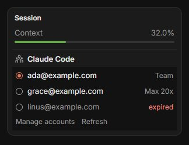
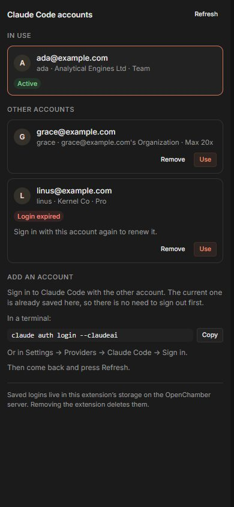

# Claude Account Switcher for OpenChamber

**English** · [Português (Brasil)](./README.pt-BR.md)

Switch the account Claude Code is signed in to, right inside [OpenChamber](https://openchamber.dev). Keep a work account and a personal account (or several organizations) signed in and swap between them with one click, without running `claude auth login` again.

Switch from the **Work Status** panel, which stays open next to the chat, or manage accounts from the extension's panel in the right-hand rail.

<p>
  
  &nbsp;
  
</p>

The switch applies to everything that reads Claude Code's login on that machine: the `claude-code` provider in OpenChamber ([opencode-claude](https://github.com/openchamber/opencode-claude)) and the `claude` CLI in your terminal.

> [!NOTE]
> This is a community extension. It is not made by or affiliated with Anthropic or the OpenChamber team. You are responsible for how you use your own accounts; if you are unsure whether something is allowed, check Anthropic's terms.

## Contents

- [Features](#features)
- [Requirements](#requirements)
- [Install](#install)
- [Usage](#usage)
- [How it works](#how-it-works)
- [Security and privacy](#security-and-privacy)
- [Limitations](#limitations)
- [Troubleshooting](#troubleshooting)
- [Development](#development)
- [Project layout](#project-layout)
- [License](#license)

## Features

- **Switch from Work Status.** A **Claude Code** section in the chat's Work Status panel lists every saved account as a radio row with its plan. The account in use is checked; click another to switch.
- **Full management in the rail panel.** See organization and plan, remove saved logins, and get the steps to add another account.
- **Saves the account in use automatically.** Sign in with another account and it shows up next to the first.
- **Always current.** Both views notice within seconds when the login changes: a switch from the other view, a sign-in from a terminal, or Claude Code rotating its tokens. The newest tokens of the active account are saved each time, and always right before a switch.
- **Touches only the login.** Replaces two JSON keys and leaves every other setting, MCP token, and project entry exactly as written, including the file's formatting.
- **Safe failure.** If the second file cannot be written, the first is put back, so Claude Code never ends up with tokens from one account and the name of another.
- **Detects a mismatched login** (credentials of one saved account under the name of another) and refuses to save it.
- **Shows plan and status**: plan (Pro, Max 5x/20x, Team, Enterprise), organization, and whether a saved login has expired.
- English and Portuguese, following OpenChamber's language. Light and dark themes follow the app.

## Requirements

| | |
| --- | --- |
| OpenChamber | 2.3.1 or later, **web or desktop** (VS Code and mobile do not load extensions) |
| Claude Code | Signed in with a Claude plan (`claude auth login --claudeai`) |
| Operating system | **Windows** or **Linux** on the machine that runs the OpenChamber server. Not macOS: see [Limitations](#limitations). |

## Install

### From GitHub

1. In OpenChamber, open **Settings → Extensions → Add**.
2. Paste `https://github.com/pedrohendp/openchamber-claude-account-switcher.git`.
3. Approve the requested access: read and write `~/.claude.json` and `~/.claude/.credentials.json`.
4. Open a chat: the **Claude Code** section appears in its Work Status panel. The **Claude Account Switcher** icon is in the right-hand rail.

Git installs can be updated from **Settings → Extensions** when a newer `version` is published. Append a tag such as `#v1.1.0` to the URL to pin that release.

### From a local folder

Clone the repository, then add the folder from **Settings → Extensions → Add**. A folder install runs from that folder, so after `bun run build` you only need to reopen the panel or section. The built bundles are committed, so a fresh clone installs without building.

## Usage

**First run.** Open a chat (or the rail panel). The account Claude Code is signed in to is saved and shown as the one in use.

**Switch from Work Status.** In the **Claude Code** section, click an account. The radio spins while the switch runs, and a toast confirms it. Accounts with an expired login are greyed out. **Manage accounts** opens the rail panel; **Refresh** re-reads the login right away.

**Switch from the rail panel.** Press **Use** on an account.

Either way, the switch applies from the next Claude Code turn; a turn that is already running finishes on the previous account. Both views say so while the open chat is busy. You can hide or move the section from the Work Status section chooser.

**Add another account.**

1. Sign in to Claude Code with the other account, without signing out first:
   - in a terminal: `claude auth login --claudeai` (the rail panel has a Copy button), or
   - in OpenChamber: **Settings → Providers → Claude Code → Sign in**.
2. Within a few seconds the new account is shown as the one in use, and the previous one stays in the list.

**Remove.** In the rail panel, press **Remove**, then confirm. This deletes the saved login for that account only. To get it back, sign in with that account again.

**Expired login.** A saved account marked **expired** has a refresh token that is past its expiry date, so Claude Code cannot renew it. Sign in with that account again; the saved copy is replaced.

## How it works

Claude Code keeps its login in two files. The extension swaps one key in each:

| File | Key replaced | Left untouched |
| --- | --- | --- |
| `~/.claude/.credentials.json` | `claudeAiOauth`: access token, refresh token, expiry, plan | `mcpOAuth` (MCP server tokens) and any other key |
| `~/.claude.json` | `oauthAccount`: account and organization the tokens belong to | projects, settings, caches, everything else |

Each saved login is identified by **account UUID + organization UUID**, because one person can belong to several organizations and each one gets its own tokens.

A switch runs these steps:

```text
1. Read both files and the saved logins.
2. Save the newest tokens of the account in use (unless they look like another account's).
3. Read the target account's saved login.
4. Write ~/.claude/.credentials.json  with the target's claudeAiOauth.
5. Write ~/.claude.json               with the target's oauthAccount.
     └─ if this fails: restore the original credentials file, report the error.
6. Read both files again and check that the target is the account in use.
```

Writes keep each file's indentation, line endings, and trailing newline. OpenChamber performs every write atomically (temporary file, then rename), so Claude Code never reads a half-written file.

**Staying in sync.** The Work Status section and the rail panel are separate pages. While one is visible it checks the size and modification time of the two files every 3 seconds and re-reads everything when they change; it also re-reads every 30 seconds (for changes that only touch saved accounts, such as a removal) and when it becomes visible, and the section re-reads when a chat turn ends. Inside each page, operations run one at a time, so a background re-read cannot interleave with a switch.

## Security and privacy

- **Scoped file access.** The manifest declares exactly two paths and asks for no project-file access. OpenChamber refuses every other path, compares canonical paths, and rejects `..`, backslashes, and symlinks that leave the allowed paths. The extension has no network access and no local process.
- **Where saved logins live.** In the extension's own storage on the OpenChamber server: `guest-storage/claude-accounts.json` in OpenChamber's data directory, written with mode `0600`. Tokens are stored as Claude Code stores them, in plain JSON; anyone who can read your user's files can read them, exactly as with `~/.claude/.credentials.json`.
- **Removing the extension deletes them.** Uninstalling clears the extension's storage, including every saved login.
- **Nothing is logged or sent anywhere.** Tokens never leave the server; the extension shows only email, organization, and plan.
- **Mismatch guard.** If the tokens on disk match the saved login of a different account than `~/.claude.json` names, nothing is saved and a warning is shown, so one account's tokens are never stored under another's name.

## Limitations

- **macOS is not supported.** Claude Code on macOS keeps its tokens in the login Keychain, not in `~/.claude/.credentials.json`, and an extension cannot reach the Keychain.
- **Linux file permissions.** OpenChamber rewrites files with default permissions (usually `0644`). After switching on Linux, run `chmod 600 ~/.claude/.credentials.json`.
- **`CLAUDE_CONFIG_DIR` is not supported.** The extension always uses `~/.claude` and `~/.claude.json`.
- **Running processes.** A Claude Code process that is already running keeps the tokens it loaded until its next turn or restart. If such a process later rewrites the credentials, the mismatch warning appears; pick the account you want again.
- **One server.** Saved logins belong to the OpenChamber server they were saved on. A remote OpenChamber switches the login on that remote machine.
- **Manage accounts needs an open project.** OpenChamber opens rail panels per project, so the section shows the link only when a project is open.

## Troubleshooting

| Symptom | What to do |
| --- | --- |
| *"The extension may not read the Claude Code files yet"* | Approve the extension's access in **Settings → Extensions**. |
| The **Claude Code** section is missing from Work Status | Reload the window after installing or updating. If you hid it, turn it back on in the Work Status section chooser. |
| **Claude Code is signed out** | Pick a saved account, or sign in with `claude auth login --claudeai`. |
| **Signed in, account unknown** | `~/.claude.json` has no `oauthAccount` yet. Run Claude Code once so it finishes setting up, then press Refresh. |
| **Login and account do not match** | The credentials on disk belong to another saved account. Pick the account you want. |
| A switch reports *files changed during the switch* | Something else wrote the files at the same moment, usually a running Claude Code. Refresh and switch again. |

To check which account Claude Code is using, run `claude auth status`.

## Development

Requires [Bun](https://bun.sh) 1.4 or later.

```bash
bun install
bun run build        # bundle panel/main.ts and status/main.ts into single IIFE files
bun test             # switch logic against fake files and fake storage
bun run type-check   # tsc --noEmit
bun run preview      # http://127.0.0.1:4517 — both pages with a simulated host
```

**Preview.** `bun run preview` serves the built rail panel and Work Status section inside a page that plays OpenChamber's part with fake accounts and in-memory files. Its toolbar simulates token rotation, a busy chat, a mismatched login, and signing out, and it shows the files, the storage, and the host calls as the pages change them. It never touches your real Claude Code login. Query parameters: `?locale=pt-BR`, `?theme=light`, `?view=panel`, `?view=status`.

**Shipping changes.** OpenChamber never compiles TypeScript: it loads `panel/main.js` and `status/main.js` as committed. Rebuild and commit both with every source change (CI fails when one is stale), and bump `version` in `package.json` so Git installs offer the update.

**Testing in OpenChamber.** Install your clone as a folder extension (see [Install](#from-a-local-folder)), run `bun run build`, and reopen the panel or section. Manifest changes (such as a new section) need a window reload.

The extension is built on the public [`@openchamber/sdk`](https://www.npmjs.com/package/@openchamber/sdk): `connectHost` for file and storage calls, `contributes.statusSection` for the Work Status section, and the SDK's UI kit in the rail panel.

## Project layout

```text
package.json            Extension manifest (the "openchamber" block) and scripts
src/                    Shared by both pages
  accounts.ts           Reading the Claude Code files, saved logins, switch and rollback (no DOM)
  accounts.test.ts      Tests for accounts.ts
  runtime.ts            Host helpers: error text, toasts, operation queue, change watching
  i18n.ts               English and Portuguese strings
status/                 Work Status section
  index.html, main.ts   Account radio list
  main.js               Built bundle that OpenChamber runs (committed)
panel/                  Rail panel
  index.html, main.ts   Account cards, remove, add-account steps
  main.js               Built bundle that OpenChamber runs (committed)
dev/
  preview.html          Simulated OpenChamber host with fake data
  serve.ts              Static server for the preview
docs/                   Screenshots
```

## License

[MIT](./LICENSE) © Pedro Arruda
