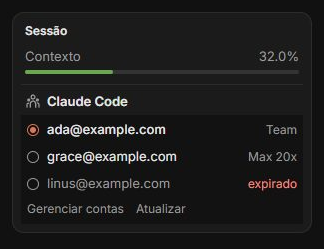
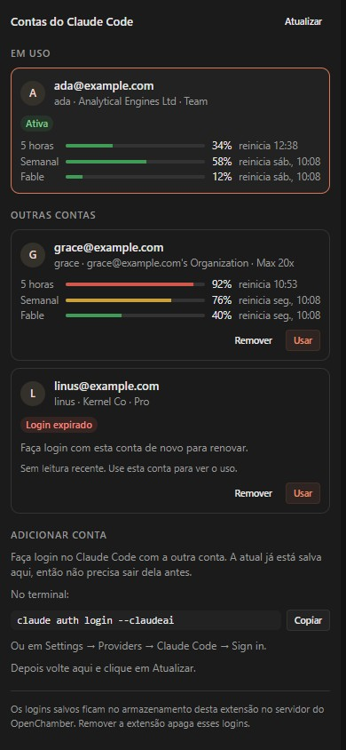

# Claude Account Switcher para OpenChamber

[English](./README.md) · **Português (Brasil)**

Troque a conta em que o Claude Code está logado sem sair do [OpenChamber](https://openchamber.dev). Mantenha uma conta de trabalho e uma pessoal (ou várias organizações) logadas e alterne entre elas com um clique, sem rodar `claude auth login` de novo.

Troque pelo painel **Work Status**, que fica aberto ao lado do chat, ou gerencie as contas no painel da extensão, no rail direito. Os dois mostram quanto de cada limite do plano cada conta já usou e quando cada limite reinicia, para você ver de relance qual conta ainda tem folga.

Listada no [catálogo de extensões do OpenChamber](https://openchamber.dev/pt/extensions/).

<p>
  
  &nbsp;
  
</p>

A troca vale para tudo que lê o login do Claude Code naquela máquina: o provider `claude-code` do OpenChamber ([opencode-claude](https://github.com/openchamber/opencode-claude)) e o `claude` no terminal.

> [!NOTE]
> Esta é uma extensão da comunidade. Ela não é feita pela Anthropic nem pelo time do OpenChamber, e não tem vínculo com eles. Você é responsável pelo uso das suas próprias contas; na dúvida sobre o que é permitido, consulte os termos da Anthropic.

## Conteúdo

- [Recursos](#recursos)
- [Requisitos](#requisitos)
- [Instalação](#instalação)
- [Uso](#uso)
- [Como funciona](#como-funciona)
- [Segurança e privacidade](#segurança-e-privacidade)
- [Limitações](#limitações)
- [Solução de problemas](#solução-de-problemas)
- [Desenvolvimento](#desenvolvimento)
- [Estrutura do projeto](#estrutura-do-projeto)
- [Licença](#licença)

## Recursos

- **Troca pelo Work Status.** Uma seção **Claude Code** no painel Work Status do chat lista todas as contas salvas em linhas de rádio, com o plano de cada uma. A conta em uso fica marcada; clique em outra para trocar.
- **Gerenciamento completo no painel lateral.** Veja organização e plano, remova logins salvos e veja os passos para adicionar outra conta.
- **Salva a conta em uso automaticamente.** Faça login com outra conta e ela aparece ao lado da primeira.
- **Sempre atualizado.** As duas telas percebem em segundos quando o login muda: uma troca feita na outra tela, um login pelo terminal ou o Claude Code renovando os tokens. Os tokens mais recentes da conta ativa são salvos a cada vez, e sempre logo antes de uma troca.
- **Mexe só no login.** Substitui duas chaves JSON e deixa todas as outras configurações, tokens de MCP e projetos exatamente como estavam, inclusive a formatação dos arquivos.
- **Falha com segurança.** Se o segundo arquivo não puder ser gravado, o primeiro volta ao original, então o Claude Code nunca fica com os tokens de uma conta e o nome de outra.
- **Detecta login trocado** (credenciais de uma conta salva com o nome de outra) e se recusa a salvá-lo.
- **Mostra plano e situação**: plano (Pro, Max 5x/20x, Team, Enterprise), organização e se um login salvo expirou.
- **Mostra o uso do plano de cada conta**: a sessão de 5 horas, o limite semanal e limites semanais por modelo, como o Fable, cada um com o percentual e a hora em que reinicia, como o `/usage` do Claude Code informa. Sempre visível no painel lateral; no Work Status, fica oculto até você clicar em **Mostrar uso**.
- Português e inglês, conforme o idioma do OpenChamber. Temas claro e escuro acompanham o app.

## Requisitos

| | |
| --- | --- |
| OpenChamber | 2.3.1 ou mais recente, **web ou desktop** (VS Code e mobile não carregam extensões) |
| Claude Code | Logado com um plano Claude (`claude auth login --claudeai`) |
| Sistema operacional | **Windows** ou **Linux** na máquina que roda o servidor do OpenChamber. macOS não: veja [Limitações](#limitações). |

## Instalação

### Pelo GitHub

O [catálogo de extensões do OpenChamber](https://openchamber.dev/pt/extensions/) aponta para este repositório; instale pelo endereço dele:

1. No OpenChamber, abra **Settings → Extensions → Add**.
2. Cole `https://github.com/pedrohendp/openchamber-claude-account-switcher.git`.
3. Aprove o acesso pedido: ler e gravar `~/.claude.json` e `~/.claude/.credentials.json`, e rodar o serviço local da extensão (ele lê o uso do plano; veja [Como funciona](#como-funciona)).
4. Abra um chat: a seção **Claude Code** aparece no painel Work Status. O ícone **Claude Account Switcher** fica no rail direito.

Instalações via Git podem ser atualizadas em **Settings → Extensions** quando uma `version` mais nova é publicada. Acrescente uma tag como `#v1.2.0` ao endereço para fixar essa versão. Quem atualiza a partir da 1.1.0 ou anterior precisa aprovar a extensão de novo, porque a 1.2.0 incluiu o serviço local.

### Por uma pasta local

Clone o repositório e adicione a pasta em **Settings → Extensions → Add**. Uma instalação por pasta roda direto daquela pasta: depois de `bun run build`, basta reabrir o painel ou a seção. Os bundles compilados estão no repositório, então um clone novo instala sem build.

## Uso

**Primeira vez.** Abra um chat (ou o painel lateral). A conta em que o Claude Code está logado é salva e aparece como a conta em uso.

**Trocar pelo Work Status.** Na seção **Claude Code**, clique numa conta. O rádio gira enquanto a troca acontece, e um aviso confirma. Contas com login expirado ficam acinzentadas. **Gerenciar contas** abre o painel lateral; **Atualizar** relê o login na hora.

**Trocar pelo painel lateral.** Clique em **Usar** numa conta.

Nos dois casos, a troca vale a partir do próximo turno do Claude Code; um turno que já está rodando termina na conta anterior. As duas telas avisam isso enquanto o chat aberto está trabalhando. Você pode esconder ou mover a seção pelo seletor de seções do Work Status.

**Adicionar outra conta.**

1. Faça login no Claude Code com a outra conta, sem sair da atual antes:
   - no terminal: `claude auth login --claudeai` (o painel lateral tem um botão Copiar), ou
   - no OpenChamber: **Settings → Providers → Claude Code → Sign in**.
2. Em poucos segundos a conta nova aparece como a conta em uso, e a anterior continua na lista.

**Ver o uso.** O painel lateral mostra os limites de cada conta abaixo do nome: 5 horas, Semanal e limites por modelo, como o Fable, com uma barra, o percentual usado e quando o limite reinicia (passe o mouse na hora para ver a data completa). Na seção do Work Status, clique em **Mostrar uso** para ver o mesmo abaixo de cada conta, e em **Ocultar uso** para recolher. **Atualizar** relê o uso na hora.

**Remover.** No painel lateral, clique em **Remover** e confirme. Isso apaga o login salvo só daquela conta. Para recuperá-lo, faça login com ela de novo.

**Login expirado.** Uma conta salva marcada como **expirado** tem o refresh token vencido, e o Claude Code não consegue renová-lo. Faça login com essa conta de novo; a cópia salva é substituída.

## Como funciona

O Claude Code guarda o login em dois arquivos. A extensão troca uma chave em cada um:

| Arquivo | Chave substituída | O que fica intacto |
| --- | --- | --- |
| `~/.claude/.credentials.json` | `claudeAiOauth`: access token, refresh token, validade, plano | `mcpOAuth` (tokens de servidores MCP) e qualquer outra chave |
| `~/.claude.json` | `oauthAccount`: conta e organização a que os tokens pertencem | projetos, configurações, caches, todo o resto |

Cada login salvo é identificado por **UUID da conta + UUID da organização**, porque a mesma pessoa pode estar em várias organizações e cada uma tem os próprios tokens.

Uma troca segue estes passos:

```text
1. Lê os dois arquivos e os logins salvos.
2. Salva os tokens mais recentes da conta em uso (a menos que pareçam ser de outra conta).
3. Lê o login salvo da conta escolhida.
4. Grava ~/.claude/.credentials.json  com o claudeAiOauth da conta escolhida.
5. Grava ~/.claude.json               com o oauthAccount da conta escolhida.
     └─ se falhar: restaura o arquivo de credenciais original e informa o erro.
6. Lê os dois arquivos de novo e confere se a conta escolhida é a que está em uso.
```

As gravações mantêm a indentação, as quebras de linha e a quebra de linha final de cada arquivo. O OpenChamber faz cada gravação de forma atômica (arquivo temporário e depois rename), então o Claude Code nunca lê um arquivo pela metade.

**Sincronização.** A seção do Work Status e o painel lateral são páginas separadas. Enquanto uma delas está visível, ela confere a cada 3 segundos o tamanho e a data de modificação dos dois arquivos e um marcador de revisão que muda sempre que uma conta é salva ou removida, e relê tudo quando algum deles muda; também relê a cada 30 segundos, quando fica visível e (a seção) quando um turno do chat termina. Dentro de cada página, as operações rodam uma de cada vez, então uma releitura em segundo plano não se mistura com uma troca.

**Um login só é salvo depois de assentar.** Fazer login grava os tokens novos e o nome da conta nova um depois do outro, então uma leitura no meio vê os tokens de uma conta com o nome de outra. Por isso um login só é salvo depois de ficar 10 segundos sem mudar; até lá, as duas telas avisam que o Claude Code está atualizando o login. Uma troca pedida nesse intervalo espera, para que o login que ela deixa seja salvo antes.

**Uso.** A Anthropic informa o uso do plano de cada conta pelo mesmo endereço que o comando `/usage` do Claude Code consulta, autenticado com o access token daquela conta. A API não aceita chamadas vindas de uma página de extensão, então a extensão traz um pequeno serviço local que o OpenChamber inicia quando precisa: a página entrega um access token, o serviço pede à Anthropic o uso daquela conta e devolve a resposta. Ele não chama mais nada. Cada leitura fica guardada por conta no armazenamento da extensão e é reaproveitada por dois minutos, então as duas telas a compartilham. Uma conta cujo access token expirou (o Claude Code só renova os tokens da conta em uso, e eles duram cerca de oito horas) continua mostrando a última leitura, com a hora em que foi feita; um limite que reiniciou desde então mostra "já reiniciou" em vez de um percentual velho. A extensão não renova esses tokens por conta própria: renovar troca o refresh token e poderia deixar um token revogado no disco se você trocasse para aquela conta no mesmo instante.

## Segurança e privacidade

- **Acesso a arquivos restrito.** O manifesto declara exatamente dois caminhos e não pede acesso aos arquivos do projeto. O OpenChamber recusa qualquer outro caminho, compara caminhos canônicos e rejeita `..`, barras invertidas e symlinks que saiam dos caminhos permitidos. As páginas em si não têm acesso à rede.
- **Um serviço local com uma única função.** O OpenChamber só o inicia depois que você aprova, liga o serviço apenas em `127.0.0.1` e entrega a ele um segredo que toda requisição precisa trazer; o serviço compara esse segredo em tempo constante. Ele aceita uma requisição pequena com um access token, chama só o endereço de uso da Anthropic (sem seguir redirecionamentos) e não herda o ambiente do OpenChamber, então nunca vê suas chaves de API nem a senha da interface.
- **Onde ficam os logins salvos.** No armazenamento da própria extensão no servidor do OpenChamber: `guest-storage/claude-accounts.json`, no diretório de dados do OpenChamber, gravado com permissão `0600`. Os tokens ficam guardados como o Claude Code os guarda, em JSON puro; quem puder ler os arquivos do seu usuário consegue lê-los, exatamente como acontece com `~/.claude/.credentials.json`.
- **Remover a extensão apaga os logins.** Desinstalar limpa o armazenamento da extensão, incluindo todos os logins salvos.
- **Nada é registrado em log.** O access token de uma conta vai só para a Anthropic, para ler o uso daquela conta, como o próprio Claude Code faz; os refresh tokens nunca saem do servidor. A extensão mostra só e-mail, organização, plano e uso.
- **Proteção contra login trocado.** Se os tokens no disco forem iguais ao login salvo de uma conta diferente da indicada no `~/.claude.json`, nada é salvo e um aviso aparece, para que os tokens de uma conta nunca fiquem guardados com o nome de outra.
- **O que você instala é o que foi revisado.** O OpenChamber roda os bundles que estão neste repositório. O CI os recompila a cada push e falha se forem diferentes do código-fonte, o CodeQL analisa o código e os workflows, as actions dos workflows ficam fixadas por SHA de commit, e o Dependabot mantém as dependências e essas fixações em dia.
- **Como relatar um problema.** Veja o [SECURITY.md](./SECURITY.md) para relatar uma vulnerabilidade de forma privada.

## Limitações

- **macOS não é suportado.** No macOS o Claude Code guarda os tokens no Keychain, não em `~/.claude/.credentials.json`, e uma extensão não tem acesso ao Keychain.
- **Permissões no Linux.** O OpenChamber regrava os arquivos com a permissão padrão (normalmente `0644`). Depois de trocar no Linux, rode `chmod 600 ~/.claude/.credentials.json`.
- **`CLAUDE_CONFIG_DIR` não é suportado.** A extensão sempre usa `~/.claude` e `~/.claude.json`.
- **Processos em execução.** Um processo do Claude Code que já está rodando mantém os tokens que carregou até o próximo turno ou até reiniciar. Se esse processo regravar as credenciais depois, o aviso de login trocado aparece; escolha de novo a conta que você quer.
- **Um servidor.** Os logins salvos pertencem ao servidor do OpenChamber em que foram salvos. Num OpenChamber remoto, a troca acontece naquela máquina remota.
- **O uso de contas paradas pode estar defasado.** O uso só é lido na hora enquanto o access token da conta vale, o que, para uma conta fora de uso, significa até cerca de oito horas depois do último uso. Depois disso aparece a última leitura, com a hora. O uso no claude.ai conta para os mesmos limites, então o valor real pode estar acima da última leitura.
- **Gerenciar contas precisa de um projeto aberto.** O OpenChamber abre painéis laterais por projeto, então a seção só mostra o link quando há um projeto aberto.

## Solução de problemas

| Sintoma | O que fazer |
| --- | --- |
| *"A extensão ainda não pode ler os arquivos do Claude Code"* | Aprove o acesso da extensão em **Settings → Extensions**. |
| A seção **Claude Code** não aparece no Work Status | Recarregue a janela depois de instalar ou atualizar. Se você a escondeu, reative-a no seletor de seções do Work Status. |
| **Claude Code sem login** | Escolha uma conta salva ou faça login com `claude auth login --claudeai`. |
| **Com login, mas sem conta identificada** | O `~/.claude.json` ainda não tem `oauthAccount`. Rode o Claude Code uma vez para ele completar a configuração e clique em Atualizar. |
| *"Não foi possível ler o uso: o serviço local da extensão não foi aprovado"* | Aprove a extensão de novo em **Settings → Extensions**; a versão 1.2.0 incluiu o serviço local no acesso pedido. |
| **Login e conta não batem** | As credenciais no disco são de outra conta salva. Escolha a conta que você quer. |
| A troca diz que os *arquivos mudaram durante a troca* | Outro programa gravou os arquivos no mesmo instante, normalmente um Claude Code em execução. Atualize e troque de novo. |

Para ver qual conta o Claude Code está usando, rode `claude auth status`.

## Desenvolvimento

Requer [Bun](https://bun.sh) 1.4 ou mais recente.

```bash
bun install
bun run build        # empacota as duas páginas (IIFE) e o serviço local (Node ESM)
bun test             # lógica de troca e de uso com arquivos e armazenamento falsos
bun run type-check   # tsc --noEmit
bun run preview      # http://127.0.0.1:4517 — as duas páginas com um host simulado
```

**Preview.** `bun run preview` serve o painel lateral e a seção do Work Status compilados dentro de uma página que faz o papel do OpenChamber, com contas falsas e arquivos em memória. A barra de ferramentas simula rotação de tokens, chat ocupado, login trocado, logout e serviço de uso não aprovado, e mostra os arquivos, o armazenamento e as chamadas ao host enquanto as páginas os alteram. Ela nunca mexe no seu login real do Claude Code. Parâmetros: `?locale=pt-BR`, `?theme=light`, `?view=panel`, `?view=status`.

**Publicando mudanças.** O OpenChamber nunca compila TypeScript: ele carrega o `panel/main.js`, o `status/main.js` e o `service/main.js` do repositório. Compile com o Bun 1.4.2, a versão que o CI usa: outras versões do Bun minificam de outro jeito, e aí o CI acusa os bundles como desatualizados. Recompile e faça commit dos três a cada mudança no código (o CI falha quando um deles está desatualizado) e aumente a `version` no `package.json` para que as instalações via Git ofereçam a atualização.

**Testando no OpenChamber.** Instale seu clone como extensão de pasta (veja [Por uma pasta local](#por-uma-pasta-local)), rode `bun run build` e reabra o painel ou a seção. Mudanças no manifesto (como uma seção nova) pedem recarregar a janela.

A extensão usa o [`@openchamber/sdk`](https://www.npmjs.com/package/@openchamber/sdk) público: `connectHost` para as chamadas de arquivo e armazenamento, `contributes.statusSection` para a seção do Work Status e o UI kit do SDK no painel lateral.

## Estrutura do projeto

```text
package.json            Manifesto da extensão (bloco "openchamber") e scripts
src/                    Compartilhado pelas duas páginas
  accounts.ts           Leitura dos arquivos do Claude Code, logins salvos, troca e rollback (sem DOM)
  accounts.test.ts      Testes de accounts.ts
  usage.ts              Uso do plano: leitura, cache e as linhas que as duas páginas mostram
  usage.test.ts         Testes de usage.ts
  runtime.ts            Helpers do host: texto de erro, avisos, fila de operações, detecção de mudanças
  i18n.ts               Textos em inglês e português
status/                 Seção do Work Status
  index.html, main.ts   Lista de contas em rádio
  main.js               Bundle compilado que o OpenChamber executa (vai no repositório)
panel/                  Painel lateral
  index.html, main.ts   Cards das contas, remover, passos para adicionar conta
  main.js               Bundle compilado que o OpenChamber executa (vai no repositório)
service/                Serviço local que o OpenChamber inicia quando precisa
  main.ts               Pede à Anthropic o uso de uma conta
  main.js               Bundle compilado que o OpenChamber executa (vai no repositório)
dev/
  preview.html          Host do OpenChamber simulado, com dados falsos
  serve.ts              Servidor estático do preview
docs/                   Screenshots
```

## Licença

[MIT](./LICENSE) © Pedro Arruda
